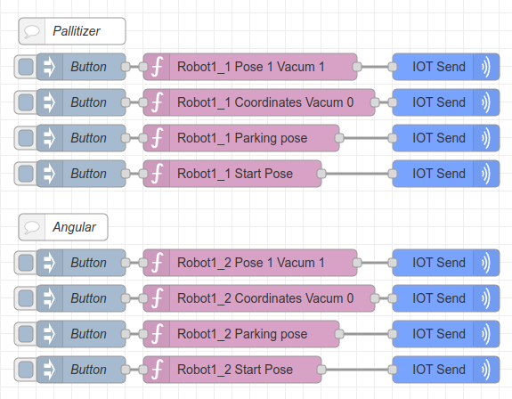
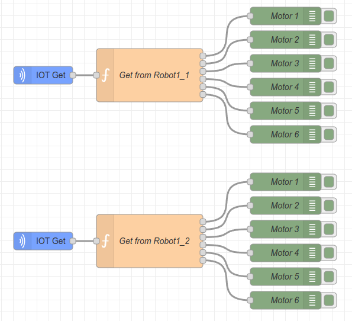
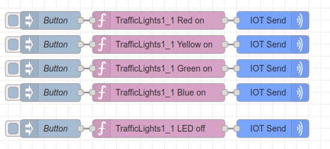
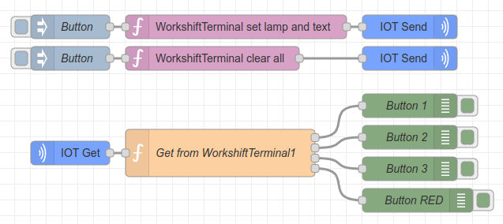
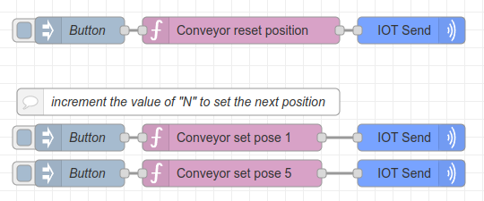
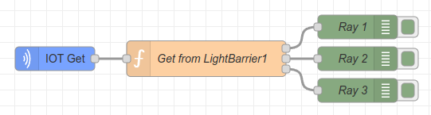
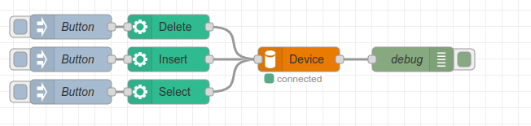

**Applied Robotics license**
---
The presented module is intended for operation, but its improvement is carried out in strict accordance with the competence development plan in the field of the Internet of Things. It is important to note that any proposals for changes can be implemented only after discussion with the expert community in this area. The collective opinion of experts plays a key role in improving the functionality and effectiveness of this module. Moreover, it is important to emphasize that the use of third-party modules is strictly prohibited within the framework of the competition, and violation of this rule may lead to disqualification of the team. This requirement is aimed at ensuring the integrity of the competition process and maintaining equal conditions for all participants.

## Install
Install via nodered pallete or run the following command in the root directory of your Node-RED install

```
npm install node-red-contrib-iot-controlcenter
```

## Example
+ Robot control\
\

---
+ TrafficLight control\

---
+ WorkshiftTerminal control\

---
+ Conveyor control\

---
+ LightBarrier control\

---
+ MySql\

---
