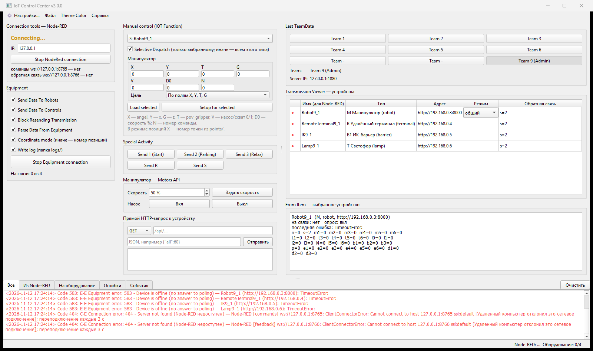
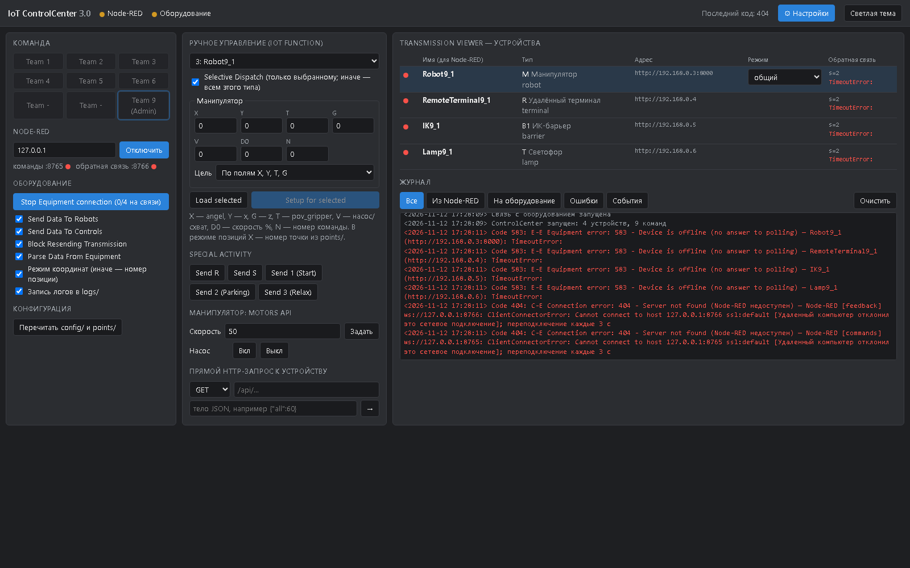
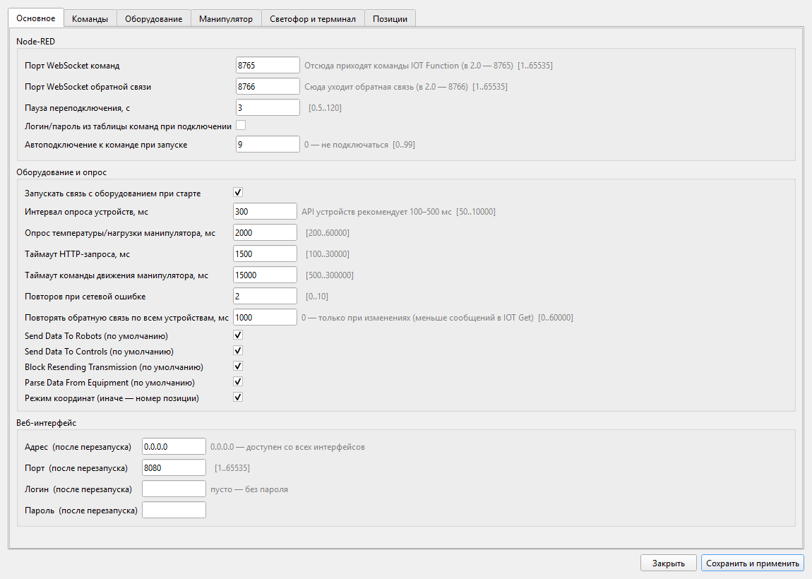
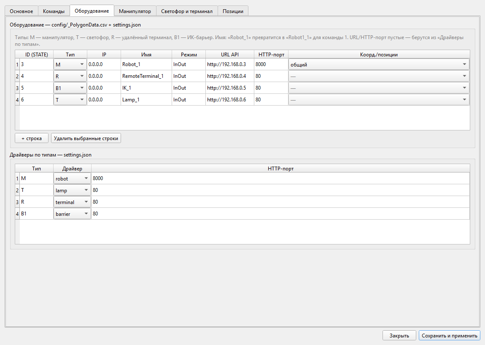

# Руководство по запуску и настройке IoT ControlCenter 3

ControlCenter 3 — связующее ПО между **Node-RED** (плагин `node-red-contrib-iot-controlcenter`)
и оборудованием учебного IoT-полигона (манипуляторы, светофоры, терминал, ИК-барьер).
Заменяет ControlCenter 2.0.x: вместо текстового UDP оборудование опрашивается по HTTP/JSON,
с подтверждением, таймаутами и повторами.

Есть три способа запуска на одном ядре:

| Способ | Для чего | Интерфейс |
|---|---|---|
| **Desktop** | проверка и наладка на стенде | окно Qt (PySide6), раскладка как в 2.0 |
| **CLI / сервер** | постоянная работа на Linux-сервере (или Windows) | консоль + веб-страница `http://сервер:8080/` |
| **Docker Compose** | сразу несколько рабочих зон (1–4) с Node-RED, MySQL и регистрацией участников | веб-интерфейс каждой зоны |

Требования: **Python 3.9+** (для вариантов без Docker), для desktop-версии — Windows/Linux/macOS с графикой.

---

## 1. Desktop-версия (окно)

### Первый запуск на Windows

Запустите `run-desktop.bat` из корня проекта. При первом запуске скрипт сам создаст
виртуальное окружение `venv-desktop` и установит PySide6 — ждать нужно один раз.

На Linux/macOS: `./run-desktop.sh`.

Программа ищет папки `config/`, `points/`, `logs/` рядом с собой. Если не находит —
предложит выбрать папку вручную. Параметры командной строки:

```
--dir ПАПКА     указать папку с config/, points/, logs/
--web 8080      дополнительно открыть веб-интерфейс на указанном порту
```

### Главное окно



Окно повторяет ControlCenter 2.0. Основные зоны:

* **Connection tools** (слева сверху) — IP Node-RED и состояние двух WebSocket-подключений:
  `8765` — сюда приходят команды IOT Function, `8766` — сюда уходит обратная связь.
* **Equipment** (слева) — флажки Send Data To Robots / Controls, Block Resending, Parse Data,
  режим координат, запись логов; кнопка Start/Stop Equipment connection.
  Ниже — счётчик «на связи N из M».
* **Manual control** (в центре) — ручная отправка IOT Function выбранному устройству.
  Поля зависят от типа устройства. Без **Selective Dispatch** команда уходит всем устройствам
  того же типа.
* **Last TeamData** (справа сверху) — выбор команды (номер Team добавляется к именам
  устройств: `Robot_1` → `Robot1_1`).
* **Transmission Viewer** — таблица устройств: имя, тип, адрес, режим, обратная связь.
  Красная точка — устройство не на связи.
* **From Item** — подробная обратная связь по выбранному устройству.
* **Внизу** — журналы: всё / из Node-RED / на оборудование / ошибки / события.
  Меню **Theme Color** переключает тёмную и светлую тему.

Пока Node-RED подключён, ручное управление заблокировано (как в 2.0). К одному Node-RED
должен быть подключён только один ControlCenter — иначе каждая команда уйдёт на оборудование дважды.

### Сборка в exe (как ControlCenter.exe)

```bat
python -m venv venv-build
venv-build\Scripts\pip install -r requirements-desktop.txt pyinstaller
venv-build\Scripts\python build\build_desktop.py
```

Результат — `dist\ControlCenter\` с `ControlCenter.exe` и рядом папки `config\`, `points\`, `logs\`.
Python на целевом компьютере не нужен.

---

## 2. CLI / серверная версия

Подходит для постоянной работы на Linux-сервере без графики (также работает на Windows/macOS/Docker).

```bash
./run-server.sh                          # первый запуск создаст venv и поставит aiohttp
./run-server.sh --team 1 --equipment     # сразу подключиться к Node-RED команды 1 и к оборудованию
./run-server.sh --no-web                 # только консоль, без веб-интерфейса
```

Полный список параметров:

```
python -m controlcenter [--dir ПАПКА] [--team N] [--nodered-ip IP] [--equipment]
                        [--no-web] [--host 0.0.0.0] [--port 8080] [--no-console] [--console] [--quiet]
```

### Консольные команды

```
status                        состояние Node-RED, оборудования, флагов
devices | dev <id>            устройства и обратная связь / подробно по одному
teams | team <N>              список команд / выбрать команду
connect [IP] | disconnect     подключение к Node-RED
start | stop                  Start/Stop Equipment connection
send <id|all> K=V ...         ручная команда:  send 3 N=1 X=30 Y=200 G=120 V=1
                              send 4 L1=1 Text="Этап 2|Нажмите СТАРТ"
btn <id|all> <r|s|1|2|3>      кнопки Special Activity
flag [robots|controls|block|parse|coord|log on|off]
mode <id> coord|pos|default   режим манипулятора
http <id> GET|POST|PATCH /path [JSON]   прямой запрос к устройству
show [all|none|error ...]     какие журналы печатать
config | get КЛЮЧ | set КЛЮЧ ЗНАЧЕНИЕ    настройки
table devices | row devices 1 URL=http://... MODE=pos    правка таблиц
reload | help | quit
```

`<id>` — STATE устройства из `config/_PolygonData.csv` (последний октет IP).

### Веб-интерфейс

Если не задан `--no-web`, по адресу `http://сервер:8080/` открывается веб-страница
с теми же возможностями: выбор команды, подключение к Node-RED, управление оборудованием,
ручное управление, прямой HTTP-запрос к устройству и журнал.



Вверху страницы — кнопка **⚙ Настройки** (тот же редактор, что в desktop), индикаторы
Node-RED и оборудования, последний код ошибки и переключатель тёмной/светлой темы.

Доступ можно закрыть паролем (Basic Auth) — задайте в `config/settings.json`:

```json
"web": { "username": "admin", "password": "секрет" }
```

(логин/пароль вступают в силу после перезапуска).

### Как служба systemd

```bash
sudo useradd -r -s /usr/sbin/nologin controlcenter
sudo mkdir -p /opt/controlcenter && sudo cp -r . /opt/controlcenter && sudo chown -R controlcenter /opt/controlcenter
cd /opt/controlcenter && sudo -u controlcenter python3 -m venv venv && sudo -u controlcenter venv/bin/pip install -r requirements.txt
sudo cp deploy/controlcenter.service /etc/systemd/system/
sudo systemctl daemon-reload && sudo systemctl enable --now controlcenter
journalctl -u controlcenter -f        # журнал
```

Служба работает без консоли (`--no-console`), управление — через веб-интерфейс.
Чтобы при старте служба сразу подключалась к Node-RED и оборудованию, задайте в
`config/settings.json` поля `"nodered": {"autoconnect_team": 1}` и `"equipment": {"autostart": true}`.

---

## 3. Docker Compose: рабочие зоны 1–4

Поднимает для каждой зоны отдельные ControlCenter, Node-RED, сервис регистрации,
MySQL и phpMyAdmin. Подробная инструкция — [launch.md](launch.md). Кратко:

```bash
docker compose --profile zone1 up -d --build                    # одна зона
docker compose --profile zone1 --profile zone2 up -d --build    # несколько зон
docker compose --profile zone1 logs -f                          # журналы зоны
docker compose down                                             # остановить всё (данные сохранятся)
```

| Зона | ControlCenter | Node-RED | Регистрация | phpMyAdmin | MySQL (localhost) |
|---|---|---|---|---|---|
| 1 | http://localhost:8081 | http://localhost:1881 | http://localhost:3001 | http://localhost:8091 | 3307 |
| 2 | http://localhost:8082 | http://localhost:1882 | http://localhost:3002 | http://localhost:8092 | 3308 |
| 3 | http://localhost:8083 | http://localhost:1883 | http://localhost:3003 | http://localhost:8093 | 3309 |
| 4 | http://localhost:8084 | http://localhost:1884 | http://localhost:3004 | http://localhost:8094 | 3310 |

Участник открывает страницу регистрации своей зоны, задаёт логин и пароль — сервис создаёт
учётные записи Node-RED и MySQL и отдельную базу. В узле **MySQLdatabase** внутри Node-RED
хост — `mysql-N` (N — номер зоны), порт `3306`. Перезапуск Node-RED не нужен.

Перед публикацией в сеть задайте собственные секреты (в `.env` или переменных окружения):
`MYSQL_ROOT_PASSWORD`, `NODE_RED_CREDENTIAL_SECRET_1`…`4`. Порты переопределяются
переменными `CONTROLCENTER_PORT_N`, `NODERED_PORT_N`, `REGISTRATION_PORT_N`,
`PHPMYADMIN_PORT_N`, `MYSQL_PORT_N`.

---

## 4. Настройка

Основные настройки меняются в самой программе — не вручную в файлах:

* **Desktop:** кнопка **⚙ Настройки…** в меню (Ctrl+,).
* **Веб-интерфейс:** кнопка **⚙ Настройки** вверху страницы.
* **CLI:** команды `config`, `get`, `set`, `table`, `row`.

### Вкладка «Основное»



* **Node-RED** — порты WebSocket команд/обратной связи, пауза переподключения,
  автоподключение к команде при запуске (0 — не подключаться).
* **Оборудование и опрос** — автозапуск связи при старте, интервал опроса (API рекомендует
  100–500 мс), таймауты HTTP-запроса и команды движения, число повторов, периодический
  повтор обратной связи (0 — только при изменениях), флажки по умолчанию.
* **Веб-интерфейс** — адрес, порт, логин/пароль. Применяются после перезапуска.

### Вкладка «Оборудование»



* **Таблица оборудования** — ID (STATE), тип, IP, имя устройства, собственный URL/HTTP-порт,
  режим координат/позиций для манипуляторов. Записывается в `config/_PolygonData.csv`
  и `config/settings.json`. Пустые URL/порт — берутся из таблицы драйверов.
* **Драйверы по типам** — какой драйвер (`robot`, `lamp`, `terminal`, `barrier`, `udp`)
  и HTTP-порт используются для каждого типа устройства.

Другие вкладки: **Команды** (IP/порт/логины Node-RED → `config/_ServerIPs.csv`),
**Манипулятор** (сопоставление полей IOT Function с Motors API, скорость, Start/Parking,
резервные позиции), **Светофор и терминал** (цвета L1–L4, разделитель строк, транслит),
**Позиции** (точки манипуляторов → `points/_Manipulator.csv`).

### Как сохраняются изменения

**«Сохранить и применить»** сначала проверяет всё целиком: IP-адреса, числа, диапазоны,
повторы ID, имён и номеров позиций. Если есть ошибки — ничего не записывается,
показывается список (код 590). Если ошибок нет — файлы записываются, и изменения
применяются сразу, связь с Node-RED и оборудованием на секунду прерывается и
восстанавливается сама. Только адрес/порт веб-интерфейса и UDP-порт требуют перезапуска.

Перед каждой записью прежняя версия файла копируется в `config/backup/`
(позиции — в `points/backup/`). Форматы файлов прежние (как в 2.0), их можно править
вручную или копировать между компьютерами; после ручной правки нажмите
«Перечитать config/ и points/» (в CLI — `reload`) или перезапустите программу.

---

## 5. Конфигурационные файлы

| Файл | Содержимое |
|---|---|
| `config/_ServerIPs.csv` | команды: `IP;PORT;NAME;USERNAME;PASSWORD` (формат 2.0) |
| `config/_PolygonData.csv` | оборудование: `STATE;KEY;IP;PORT;NAME;ENTRANCE` (формат 2.0) |
| `config/settings.json` | драйверы, HTTP-порты, сопоставление полей, интервалы, веб-интерфейс |
| `points/_Manipulator.csv` | позиции манипуляторов: `NUM;X;Y;T;Z` |
| `logs/` | `log_From_NodeRed_TeamN.txt`, `log_From_Equipment_TeamN.txt`, `log_ErrorCode_TeamN.txt` |

Типы устройств: **M** — манипулятор, **T** — светофор, **R** — удалённый терминал,
**B1** — ИК-барьер. Старые типы P1/M1 читаются как M, R2 — как R.
Устройства на старом UDP (конвейер C, камера SC, сканер BR) поддерживаются прежним
протоколом (порт 8888), но скрыты из интерфейсов.

---

## 6. Проверка без оборудования

Эмулятор стенда и «Node-RED» для наладки без железа:

```bash
python3 tools/emulator.py
# манипуляторы :9101/:9102, лампы :9201/:9202, терминал :9301, барьер :9401,
# «Node-RED» ws :8765/:8766 и http://127.0.0.1:1880/inject
```

Пропишите в `config/settings.json → devices` URL эмулятора (например
`"3": {"url": "http://127.0.0.1:9101"}`) и выберите команду с IP `127.0.0.1`.
Отправка команды «из Node-RED»:

```bash
curl -d '{"robot_name":"Robot9_1","N":1,"X":200,"Y":30,"T":15,"G":120,"V":1,"Text":""}' http://127.0.0.1:1880/inject
curl http://127.0.0.1:1880/feedback       # что пришло в Node-RED
```

---

## 7. Диагностика

Типичные коды в журнале:

| Код | Значение |
|---|---|
| 404 | Node-RED недоступен — проверьте IP и порты 8765/8766 |
| 583 | устройство не отвечает на опрос — проверьте IP, HTTP-порт и питание устройства |
| 584 | устройство ответило HTTP-ошибкой, в тексте — причина |
| 590 | в настройках ошибка, изменения не сохранены — смотрите список в сообщении |

Ошибки «устройство не на связи» (код 583) сами исчезают при восстановлении связи —
ControlCenter продолжает опрашивать устройство. Журналы работы — на вкладке «Всё»
внизу окна (desktop), в панели «Журнал» (веб) и в папке `logs/`.

Сквозные тесты на эмуляторе: `python -m pytest -q`.
